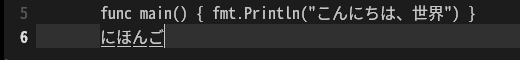
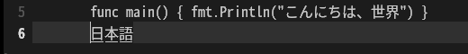

# ngw

**Windows 向け・日本語完全対応の、軽くて速い Neovim GUI。**

[Shougo/ng](https://github.com/Shougo/ng)（Linux 専用の最小 Neovim GUI）の設計思想と
コア（msgpack-RPC・グリッド管理・文字幅）を受け継ぎ、描画と入力を Win32
（GDI + IMM32）で書き直したものです。cgo なしの純 Go、依存ライブラリなし、
単体 exe（約 2.6MB）で動きます。

> ngw は ng とは別のプロジェクトで、ng の作者による公認・保守はありません。
> 不具合の報告は ng ではなく、このリポジトリへお願いします。


## 特徴

- **日本語入力（IME）をインライン表示**：変換中の文字列はカーソル位置に直接描画され、
  変換候補ウィンドウは変換中の文節の真下に出ます（`IMR_QUERYCHARPOSITION` にも応答）。

  
  
- **ノーマルモードで IME が邪魔しない**：挿入・置換・コマンドライン・ターミナルモード以外では
  IME を切り離すので、IME をオンにしたまま `Esc` しても `dd` や `:w` がそのまま効きます。
  挿入モードに戻ると IME の状態（オン/オフ）が復元されます。
- **全角・半角の正しい描画**：Neovim が決めたセル幅に必ず収めます。全角文字はセル 2 つ分に、
  `ambiwidth=single` で幅広に描かれる記号（○ ※ → など）はセル内に横縮小して描くので、
  はみ出しや描画の残骸が出ません。
- **フォントのフォールバック**：`guifont` にない文字は `guifontwide` → BIZ UDゴシック →
  MS ゴシック → 游ゴシック → Nerd Font → Segoe UI Symbol … の順に自動で探します。
- **クリップボードがそのまま使える**：`"+y` `"+p` が Windows のクリップボード
  （UTF-16）と直結。win32yank.exe 不要で、行単位/文字単位の区別も保ちます。
- **速い**：
  - Neovim が `flush` した完全な画面だけを描く（描きかけを見せない・無駄な描画をしない）
  - 変化した行だけを再描画し、スクロールは画素を `BitBlt` で動かすだけ
    （スクロール後の画面と全再描画した画面がピクセル単位で一致することを確認済み）
  - 同じ色・同じフォントの連続文字は `ExtTextOutW` 1 回で描画
  - アニメーションなし、カーソル点滅なし
- **高 DPI 対応**（Per-Monitor v2）。モニタ間の移動でもぼやけません。
- ファイルのドラッグ＆ドロップ（`:drop`）、マウス（クリック・ドラッグ・ホイール・横ホイール）、
  `:set guifont=*` でフォント選択ダイアログ、ダークテーマ時は自動でタイトルバーも暗色。

ng と同じく、**画面は Neovim が描いたものだけ**を表示します（`ext_linegrid` のみ）。
GUI 独自のタブ・メニュー・サイドバーはありません。ターミナルで動くものはそのまま動きます。

## インストール

1. Neovim を入れる（0.10 以降推奨）

   ```powershell
   winget install Neovim.Neovim
   ```

2. `ngw.exe` を入手する
   - GitHub Actions の成果物（`ngw-windows-amd64`）をダウンロード、または
   - 自分でビルド（Go 1.24 以上）：

     ```powershell
     .\build.ps1
     ```

     Linux/macOS からのクロスビルドは `make`。

3. `ngw.exe` を好きな場所に置いて実行。`nvim.exe` は PATH、winget、scoop、
   `C:\Program Files\Neovim` から自動で探します。

## 使い方

```text
ngw [オプション] [--] [nvim の引数...]

  --nvim PATH            使う nvim.exe
  --server HOST:PORT     起動済みの "nvim --listen HOST:PORT" に接続
  --geometry COLSxROWS   起動時の桁数×行数（既定 100x32）
  --maximized            最大化して起動
```

それ以外の引数は nvim に渡ります（例：`ngw -O a.txt b.txt`）。

## 設定

設定ファイルはありません。普段の `init.lua` / `init.vim` に書きます。
ngw から起動したときは `g:ngw` が 1 になります。

```lua
if vim.g.ngw then
  vim.o.guifont = 'BIZ UDGothic:h12'      -- 既定。HackGen_Console_NF:h11 なども可
  -- vim.o.guifontwide = 'BIZ UDGothic'   -- 全角文字だけ別フォントにしたいとき
  -- vim.o.linespace = 2                  -- 行間（ピクセル）
  vim.o.ambiwidth = 'double'              -- ○※→ などを全角幅で扱う（日本語なら推奨）

  -- vim.g.ngw_ime_off_on_leave = 1  -- 挿入モードを抜けたら IME を必ずオフに
  -- vim.g.ngw_ime_insert_only = 0   -- ノーマルモードでも IME を使う
  -- vim.g.ngw_clipboard = 0         -- 内蔵クリップボードを使わない
  -- vim.g.ngw_fullscreen = 1        -- 全画面（0 で戻る）
end
```

| 設定 | 意味 |
|---|---|
| `guifont` | `名前:h大きさ[:b][:i][:qCLEARTYPE\|qANTIALIASED\|qNONANTIALIASED]`、`,` 区切りで複数可。名前の空白は `_` でも可。`*` でダイアログ |
| `guifontwide` | 全角文字に優先して使うフォント |
| `linespace` | 行間 |
| `g:ngw_ime_insert_only` | 既定 1。文字入力モード以外では IME を切り離す |
| `g:ngw_ime_off_on_leave` | 既定 0。1 にすると挿入モードを抜けるたびに IME をオフ |
| `g:ngw_clipboard` | 既定 1。0 で内蔵プロバイダを無効化（`g:clipboard` を自分で設定した場合も無効） |
| `g:ngw_fullscreen` | 1 で全画面、0 で元に戻す |

キー操作：`Ctrl+Shift+V` でクリップボードを貼り付け（ターミナルと同じ。挿入・コマンドラインどちらでも）。
ウィンドウを閉じると `:confirm qall` 相当（未保存なら確認が出ます）。

## 構成

```text
cmd/ngw            起動・引数
internal/gui       ウィンドウ、描画（GDI）、IME、マウス、クリップボード  ← Windows 用に新規
internal/win32     Win32 API 宣言（syscall のみ、cgo なし）               ← 新規
internal/screen    グリッド状態（ng から。スクロールを blit にするフックを追加）
internal/input     キー表記変換（ng から。仮想キーコード対応を追加）
internal/nvim      nvim の起動と bootstrap Lua（ng から。stdio 接続・クリップボードを追加）
internal/rpc, msgpack, width   ng から流用
```

## 制限事項

- 色付き絵文字は GDI の制約で単色表示です。リガチャ（合字）は描画しません（ng と同じ）。
- ng と違い、GUI が落ちると Neovim も終了します（Windows では stdio の `--embed` 接続のため）。
  Neovim を残したい場合は `nvim --listen 127.0.0.1:6666` を別に起動して `ngw --server 127.0.0.1:6666`。
- `--server` は TCP のみ（名前付きパイプ未対応）。

## ライセンス

MIT（[LICENSE](LICENSE)）。ng（© Shougo Matsushita, MIT）由来部分の著作権表示と許諾文は
[LICENSE.ng](LICENSE.ng) にあります。ngw.exe を配布するときは、この 2 つのファイルを同梱してください。
